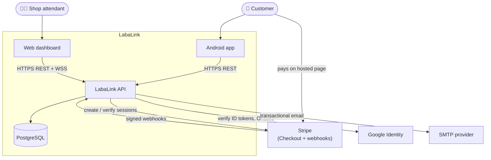
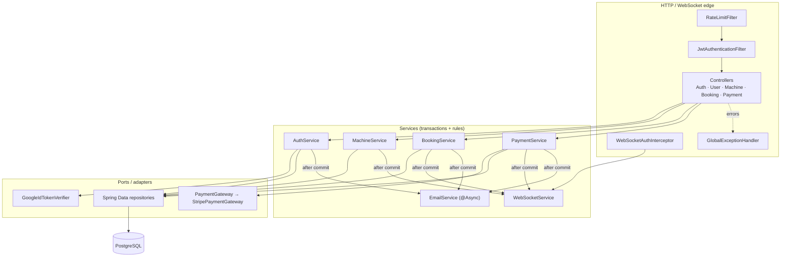
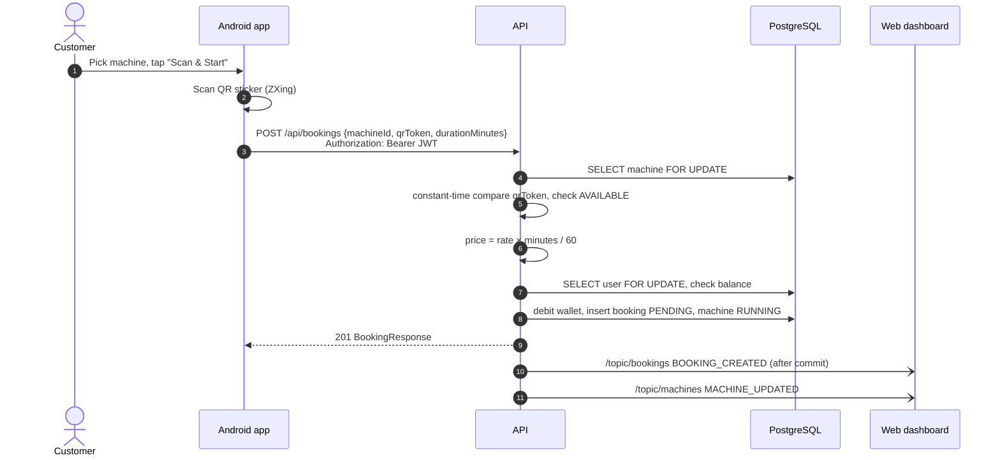
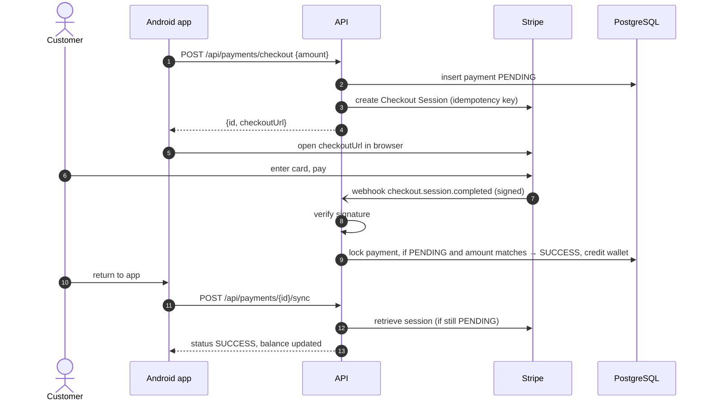
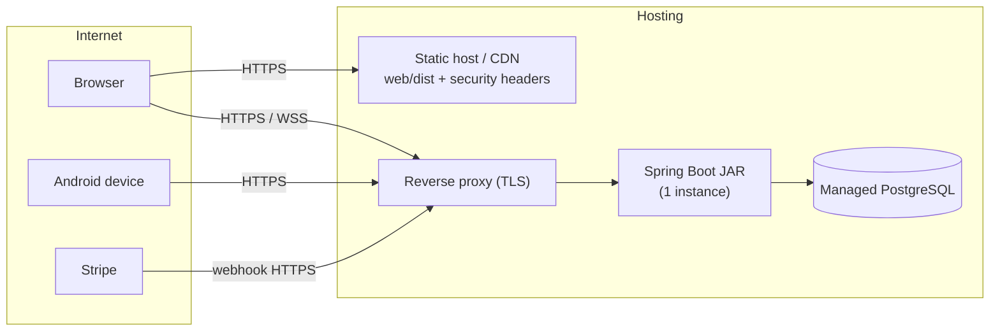

# Architecture

This is the high-level view of how LabaLink is put together. Detailed
component, class and sequence designs live in [docs/SDD.md](docs/SDD.md).
The reasons behind each choice are in [DECISIONS.md](DECISIONS.md).

## 1. System context

## 2. Containers

| Container | Tech | Responsibility |
|---|---|---|
| **API** (`backend/`) | Java 17, Spring Boot 3.5, Spring Security, Spring Data JPA, STOMP, Flyway | Business rules, authN/authZ, payments, real-time events, email |
| **Database** | PostgreSQL 14+ | System of record for users, machines, bookings, payments, email logs |
| **Web dashboard** (`web/`) | React 19, TypeScript, Vite 7, Tailwind 4, Axios, SockJS/STOMP | Attendant operations: machines, bookings, transactions, staff |
| **Android app** (`mobiledev/`) | Kotlin, Views/ViewBinding, Retrofit, OkHttp, ZXing, Google Sign-In | Customer self-service: browse, scan to start, wallet, history |

## 3. Backend layers

**Rules of the road**

- Controllers are thin: validate input (`@Valid`), check the role
  (`@PreAuthorize`), and pass the authenticated `UserPrincipal` to a service.
- Services own transactions and business rules: pricing, state machines,
  ownership, locking.
- Side effects (WebSocket pushes, emails) run **after commit**
  (`AfterCommit`), so clients never see rolled-back changes.
- External providers sit behind interfaces (`PaymentGateway`), so the money
  logic is testable without Stripe.

## 4. Key runtime flows

### Scan-to-start booking

### Wallet top-up

## 5. Security architecture

Defence in depth, from the outside in:

1. **Edge**: HTTPS, CORS allow-list, security headers, per-IP rate limits.
2. **Identity**: JWT verification on every request; user reloaded from
   the DB (active flag, role, token version).
3. **Authorisation**: URL rules (deny by default), then `@PreAuthorize`
   role checks, then ownership checks in services.
4. **Integrity**: server-side pricing, a state machine, row locks,
   idempotent payment crediting, DB constraints.
5. **Data**: BCrypt passwords, exact decimals, escaped email templates,
   no secrets in the repo.

Full details: [SECURITY.md](SECURITY.md).

## 6. Deployment view

The API currently runs as a **single instance**: rate limits, lockouts and
OAuth2 codes are in memory, and the STOMP broker is the in-process simple
broker. Scaling out requires Redis (shared counters and codes) and a
broker relay such as RabbitMQ. This is tracked in [ROADMAP.md](ROADMAP.md).

## 7. Cross-cutting concerns

| Concern | Approach |
|---|---|
| Configuration | `application.yml` + environment variables / `backend/.env`; typed `AppProperties` |
| Schema | Flyway (`db/migration`), Hibernate `ddl-auto=validate` |
| Errors | `ApiException` (safe messages) + `GlobalExceptionHandler` (generic 500s) |
| Time | Server clock; JDBC time zone UTC |
| Observability | SLF4J logs (no tokens or PII bodies), `/actuator/health` |
| Testing | MockMvc + embedded PostgreSQL integration tests; fake payment gateway |
