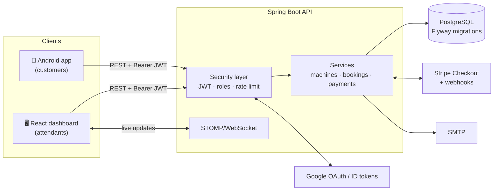

# 🫧 LabaLink — Smart Laundry Management System

LabaLink connects a self-service laundry shop with its customers.
Customers find a free machine in the **Android app**, top up a digital
wallet through **Stripe**, and start a wash by **scanning the QR sticker**
on the machine. Shop attendants run the floor from a **web dashboard**:
they manage machines, activate and complete sessions, and watch everything
update **live**.

> IT342 project · Spring Boot 3.5 · React 19 · Kotlin/Android · PostgreSQL

---

## Contents

- [Features](#features)
- [Architecture](#architecture)
- [Repository layout](#repository-layout)
- [Quick start](#quick-start)
- [Configuration](#configuration)
- [Testing](#testing)
- [Security](#security)
- [Documentation](#documentation)
- [Roadmap](#roadmap)

---

## Features

| | Customer (Android) | Attendant (Web) |
|---|---|---|
| **Accounts** | Email/password or Google sign-in | Email/password or Google (attendant accounts only) |
| **Machines** | Browse washers and dryers with live status | Create, edit, retire machines; print QR stickers; rotate QR codes |
| **Sessions** | Scan the machine QR to start; cancel while pending (auto-refund) | Activate → Complete, or Cancel with refund; live booking feed |
| **Wallet** | Top up via Stripe Checkout; history of top-ups | Read-only view of all top-ups and collected revenue |
| **Staff** | — | Add other attendants |
| **Notifications** | Email: welcome, confirmation, completion, top-up | Real-time updates over WebSocket |

## Architecture



More detail: [ARCHITECTURE.md](ARCHITECTURE.md) and [docs/SDD.md](docs/SDD.md).

## Repository layout

```
.
├── backend/      Spring Boot REST + WebSocket API (Java 17, Maven)
├── web/          Attendant dashboard (React 19, Vite, TypeScript, Tailwind 4)
├── mobiledev/    Customer app (Kotlin, Android SDK 24+, Retrofit)
├── docs/         PRD, SRS, SDD, TRD, UI/UX, app flow, schema, plan
├── ARCHITECTURE.md  CHANGELOG.md  DECISIONS.md  ROADMAP.md  SECURITY.md
```

## Quick start

### Prerequisites

| Tool | Version |
|---|---|
| JDK | 17+ |
| PostgreSQL | 14+ |
| Node.js | 20+ |
| Android Studio | Current stable (AGP 9.1, Android SDK 35) |
| Stripe account | Test mode keys (free) |

### 1. Database

```bash
createdb labalink      # or create it in pgAdmin
```

Tables are created and upgraded automatically by **Flyway** on startup.
Databases created by older LabaLink builds are upgraded in place.

### 2. Backend

```bash
cd backend
cp .env.example .env           # then fill in the values
# at minimum: DB_PASSWORD, JWT_SECRET, BOOTSTRAP_ATTENDANT_EMAIL/PASSWORD
./mvnw spring-boot:run         # Windows: mvnw.cmd spring-boot:run
```

Generate a JWT secret with `openssl rand -base64 48`.
The API listens on `http://localhost:8080`; `GET /actuator/health` returns
`{"status":"UP"}`.

On first start, the account in `BOOTSTRAP_ATTENDANT_EMAIL` becomes the first
attendant. Use it to sign in to the dashboard and add colleagues from
**Staff**.

### 3. Web dashboard

```bash
cd web
cp .env.example .env.local     # VITE_API_URL=http://localhost:8080
npm ci
npm run dev                    # http://localhost:5173
```

### 4. Android app

1. Open `mobiledev/` in Android Studio.
2. Add to `mobiledev/local.properties` (not committed):
   ```properties
   # Emulator: 10.0.2.2 is your computer. Phone: use your PC's LAN IP.
   labalink.apiBaseUrl=http://10.0.2.2:8080/
   # Optional, enables "Continue with Google"
   labalink.googleWebClientId=YOUR_WEB_CLIENT_ID.apps.googleusercontent.com
   ```
3. Run the `app` configuration.

### 5. Payments (optional for local dev)

```bash
stripe listen --forward-to localhost:8080/api/payments/webhook
# copy the whsec_... value into STRIPE_WEBHOOK_SECRET
```

Test card: `4242 4242 4242 4242`, any future date, any CVC. Without the
Stripe CLI, the app still confirms payments by calling
`POST /api/payments/{id}/sync` when you return from checkout.

## Configuration

All secrets come from environment variables (or `backend/.env`, which is
git-ignored). See [`backend/.env.example`](backend/.env.example) for the full
list. Key settings:

| Variable | Purpose |
|---|---|
| `DB_URL`, `DB_USERNAME`, `DB_PASSWORD` | PostgreSQL connection |
| `JWT_SECRET` | HMAC key for access tokens (**required**, ≥ 32 bytes) |
| `CORS_ALLOWED_ORIGINS` | Comma-separated web origins allowed to call the API |
| `FRONTEND_URL` | Where OAuth and Stripe redirect back to |
| `GOOGLE_CLIENT_ID` / `GOOGLE_CLIENT_SECRET` | Web Google login |
| `GOOGLE_CLIENT_IDS` | Client IDs accepted for Android Google ID tokens |
| `STRIPE_SECRET_KEY`, `STRIPE_WEBHOOK_SECRET` | Payments |
| `MAIL_USERNAME`, `MAIL_PASSWORD` | SMTP (Gmail: use an App Password) |
| `BOOTSTRAP_ATTENDANT_*` | First attendant account |

## Testing

```bash
cd backend && ./mvnw test       # 32 tests on a real embedded PostgreSQL
cd web && npm run lint && npm run build
cd mobiledev && ./gradlew :app:assembleDebug :app:lintDebug
```

The backend suite covers authentication, authorisation (role and
ownership), the booking and wallet money flows, Stripe idempotency,
WebSocket subscription security, rate limiting, and upgrading a legacy
database.

## Security

Security is a first-class requirement. The highlights:

- Stateless **JWT** auth on every endpoint, with **role checks** and
  **ownership checks**. The server never trusts a user ID, role or price
  sent by a client.
- **Google ID tokens are cryptographically verified**. Roles are never
  self-assigned.
- **Brute-force protection**: per-IP rate limiting plus per-account lockout.
- **Payments are verified with Stripe on the server**, credited exactly once
  (row locks + idempotency), and webhooks are signature-checked. No card data
  touches LabaLink.
- **QR codes are 144-bit secrets** compared in constant time and hidden from
  customers.
- Locked-down **CORS**, strict **security headers**, authenticated
  **WebSockets**, no stack traces in errors.
- Android: tokens encrypted with the **Android Keystore**, HTTPS-only
  release builds, no backups of session data.

Full threat model and controls: **[SECURITY.md](SECURITY.md)**. To report a
vulnerability, see the same file.

## Documentation

| Document | What it covers |
|---|---|
| [PRD](docs/PRD.md) | Product goals, personas, scope, success metrics |
| [SRS](docs/SRS.md) | Functional and non-functional requirements, use cases, diagrams |
| [SDD](docs/SDD.md) | Software design: components, classes, sequences, states |
| [TRD](docs/TRD.md) | Technical requirements, API contract, environments |
| [UI/UX Design](docs/UI-UX-Design.md) | Design system, screens, accessibility |
| [App Flow](docs/App-Flow.md) | Screen-by-screen user journeys |
| [Backend Schema](docs/Backend-Schema.md) | ERD, tables, constraints, migrations |
| [Implementation Plan](docs/Implementation-Plan.md) | Phases, tasks, testing and release plan |
| [Architecture](ARCHITECTURE.md) | System architecture overview |
| [Decisions](DECISIONS.md) | Architecture Decision Records (ADRs) |
| [Changelog](CHANGELOG.md) | Release history |
| [Roadmap](ROADMAP.md) | What's next |
| [Security](SECURITY.md) | Threat model, controls, disclosure policy |

## Roadmap

Highlights: password reset, refresh tokens, push notifications, pagination,
Redis-backed rate limiting for multi-instance deploys, CI/CD, and machine
IoT integration. See [ROADMAP.md](ROADMAP.md).
