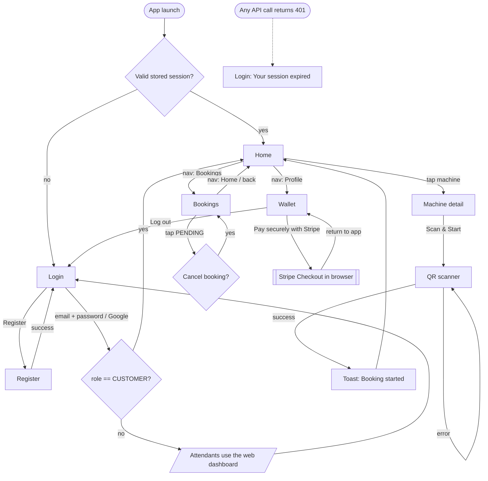
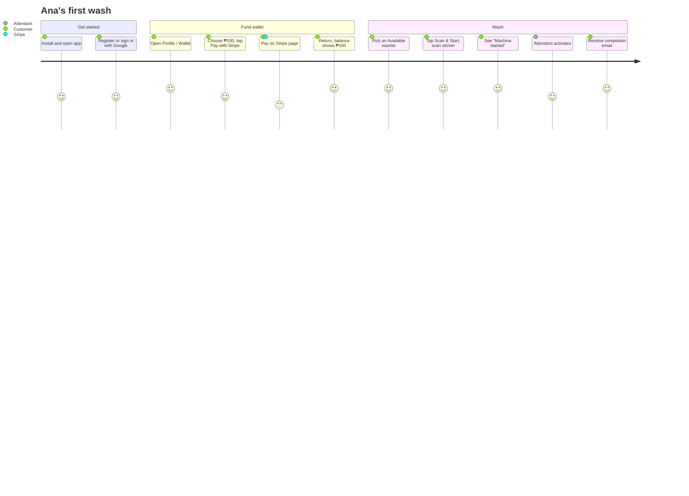
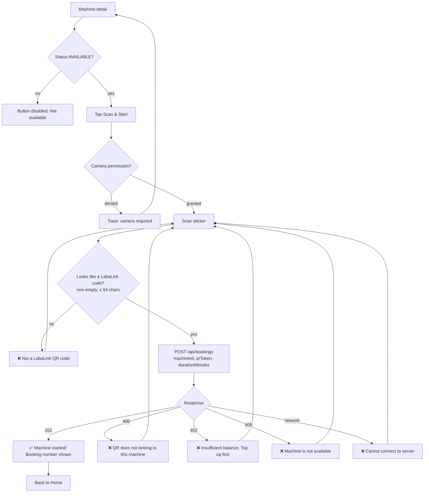
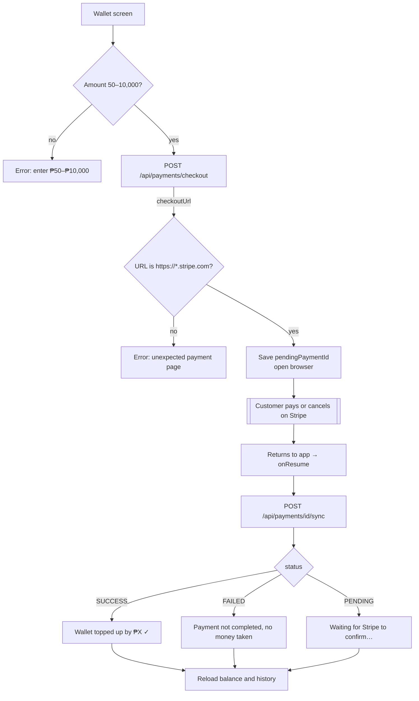
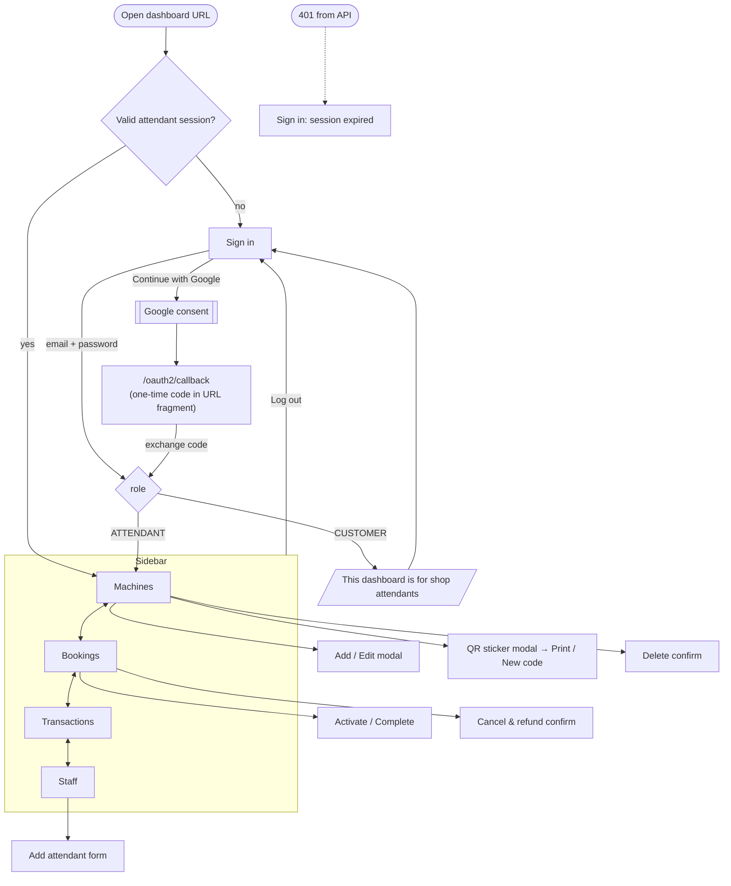
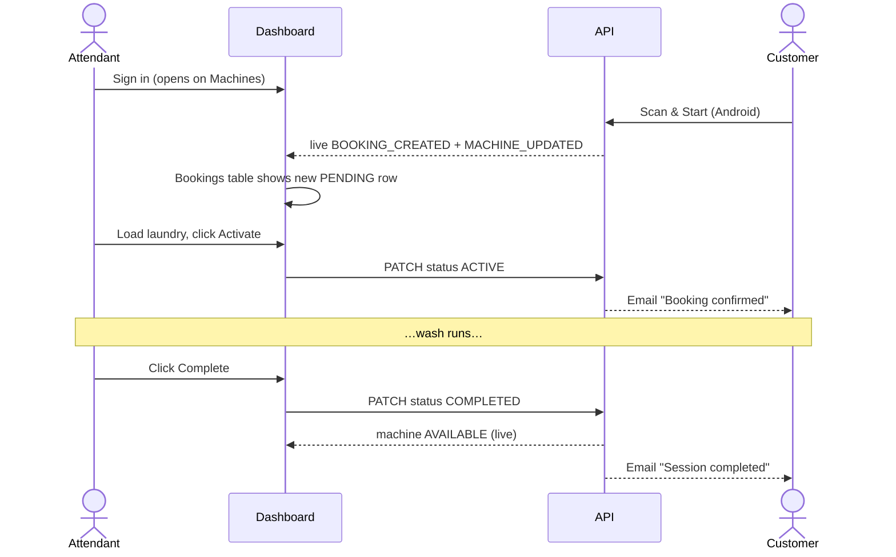
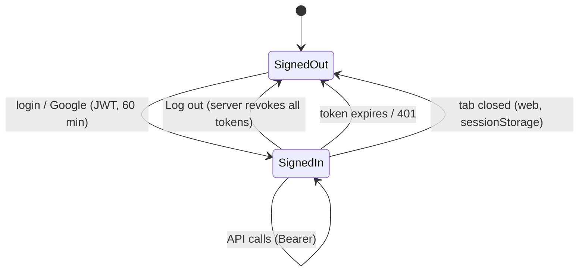

# App Flow

How users move through LabaLink, screen by screen. For screen layouts see
[UI-UX-Design.md](UI-UX-Design.md). For API details see [TRD](TRD.md).

---

## 1. Customer app (Android)

### 1.1 Navigation map

### 1.2 First wash (happy path)

### 1.3 Scan & Start: detailed flow

### 1.4 Wallet top-up flow

### 1.5 Google sign-in (Android)

1. The *Continue with Google* button is visible only if
   `labalink.googleWebClientId` is configured.
2. Account picker → Google returns an **ID token**.
3. App → `POST /api/auth/google {idToken}` → the server verifies it with
   Google.
4. On success the token is encrypted with the Keystore key and saved →
   Home.

## 2. Attendant dashboard (Web)

### 2.1 Navigation map

### 2.2 Daily operations flow

### 2.3 Machine setup flow

1. **Machines → + Add New Machine** → name, type, rate, status → *Add
   Machine*.
2. The QR sticker modal opens automatically → **Print** → stick it on the
   machine.
3. If a sticker is damaged or photographed: **View / Print → New code** →
   confirm → reprint. The old code stops working immediately.
4. To retire a machine that has history, set it **Out of Order** (delete
   is blocked with an explanation).

### 2.4 Staff onboarding flow

1. First install: the server creates the attendant from
   `BOOTSTRAP_ATTENDANT_*`.
2. That attendant signs in → **Staff** → *Add Attendant* (name, email,
   temporary password) → shares the password privately.
3. The new attendant signs in with that password, or with Google if their
   Google email matches.

## 3. Cross-cutting flows

### 3.1 Session lifecycle

### 3.2 Error handling pattern (both apps)

| Server says | App shows |
|---|---|
| 400 / 402 / 409 with `message` | That message in a red banner or toast |
| 401 (signed in) | Session cleared → login with "session expired" |
| 403 | "Access denied" (should not happen through normal UI) |
| 429 | "Too many attempts. Try again in 15 minutes." / "Please slow down." |
| Network error | "Cannot connect to server." |
