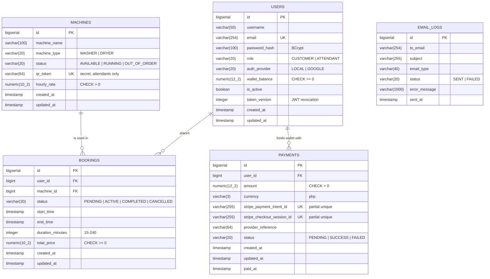
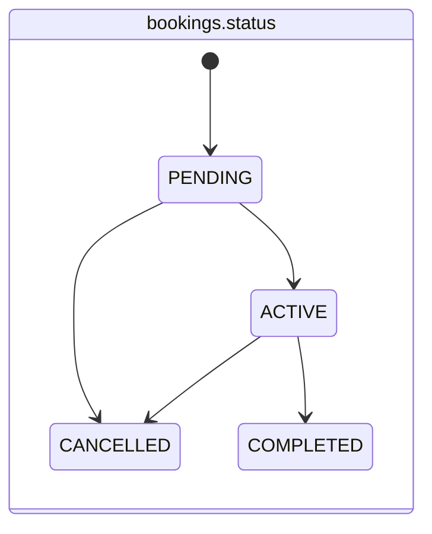
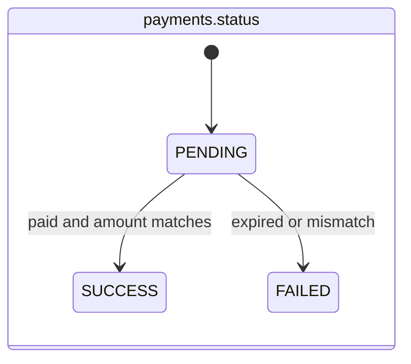

# Backend Schema

| | |
|---|---|
| **Database** | PostgreSQL 14+ |
| **Migrations** | Flyway, `backend/src/main/resources/db/migration` |
| **ORM** | Spring Data JPA / Hibernate (`ddl-auto=validate`) |
| **Source of truth** | [`V1__init_schema.sql`](../backend/src/main/resources/db/migration/V1__init_schema.sql) |

---

## 1. Entity-relationship diagram



`EMAIL_LOGS` is deliberately not linked by foreign key, so the log
survives even if a user row is removed.

## 2. Tables

### 2.1 `users`

| Column | Type | Null | Default | Notes |
|---|---|---|---|---|
| `id` | `BIGSERIAL` | no | | PK |
| `username` | `VARCHAR(50)` | no | | Display name; validated `[letters digits space . _ -]`, 3–50 |
| `email` | `VARCHAR(254)` | no | | **Unique** (`ux_users_email`); stored lower-case and trimmed |
| `password_hash` | `VARCHAR(100)` | no | | BCrypt (cost 12). Google accounts get a random, unusable hash |
| `role` | `VARCHAR(20)` | no | `'CUSTOMER'` | `CUSTOMER` or `ATTENDANT` |
| `auth_provider` | `VARCHAR(20)` | no | `'LOCAL'` | `LOCAL` (password login allowed) or `GOOGLE` |
| `wallet_balance` | `NUMERIC(12,2)` | no | `0` | `CHECK (wallet_balance >= 0)` |
| `is_active` | `BOOLEAN` | no | `TRUE` | Inactive users are rejected on every request |
| `token_version` | `INTEGER` | no | `0` | Embedded in the JWT as `tv`; incremented on logout |
| `created_at` | `TIMESTAMP` | no | `now` | |
| `updated_at` | `TIMESTAMP` | yes | | Set by `@PreUpdate` |

### 2.2 `machines`

| Column | Type | Null | Default | Notes |
|---|---|---|---|---|
| `id` | `BIGSERIAL` | no | | PK; shown as `MAC-001` |
| `machine_name` | `VARCHAR(100)` | no | | |
| `machine_type` | `VARCHAR(20)` | no | | `WASHER` or `DRYER` |
| `status` | `VARCHAR(20)` | no | `'AVAILABLE'` | `AVAILABLE`, `RUNNING`, `OUT_OF_ORDER` |
| `qr_token` | `VARCHAR(64)` | no | | **Unique**; `LL-` + 24 base64url chars (144 bits). Never sent to customers |
| `hourly_rate` | `NUMERIC(10,2)` | no | | `CHECK (hourly_rate > 0)`; app limit ₱1–₱10,000 |
| `created_at` / `updated_at` | `TIMESTAMP` | | | |

### 2.3 `bookings`

| Column | Type | Null | Default | Notes |
|---|---|---|---|---|
| `id` | `BIGSERIAL` | no | | PK |
| `user_id` | `BIGINT` | no | | FK → `users.id`; index `ix_bookings_user_id` |
| `machine_id` | `BIGINT` | no | | FK → `machines.id`; index `ix_bookings_machine_id` |
| `status` | `VARCHAR(20)` | no | `'PENDING'` | See state machine below; index `ix_bookings_status` |
| `start_time` | `TIMESTAMP` | no | | Server time when scanned |
| `end_time` | `TIMESTAMP` | yes | | Planned end; overwritten with the actual end on complete or cancel |
| `duration_minutes` | `INTEGER` | no | `60` | 15–240 |
| `total_price` | `NUMERIC(10,2)` | no | | `rate × minutes ÷ 60`, half-up; `CHECK (>= 0)` |
| `created_at` / `updated_at` | `TIMESTAMP` | | | |

### 2.4 `payments`

| Column | Type | Null | Default | Notes |
|---|---|---|---|---|
| `id` | `BIGSERIAL` | no | | PK; also the Stripe idempotency key suffix |
| `user_id` | `BIGINT` | no | | FK → `users.id`; index `ix_payments_user_id` |
| `amount` | `NUMERIC(12,2)` | no | | `CHECK (amount > 0)`; app limit ₱50–₱10,000 |
| `currency` | `VARCHAR(3)` | no | `'php'` | Must match Stripe's reported currency |
| `stripe_checkout_session_id` | `VARCHAR(255)` | yes | | Partial unique index `ux_payments_session` |
| `stripe_payment_intent_id` | `VARCHAR(255)` | yes | | Filled on success; partial unique `ux_payments_intent` |
| `provider_reference` | `VARCHAR(64)` | yes | | Human reference `LL-{id}-{last 8 of session}` |
| `status` | `VARCHAR(20)` | no | `'PENDING'` | `PENDING`, `SUCCESS`, `FAILED` |
| `created_at` / `updated_at` / `paid_at` | `TIMESTAMP` | | | |

### 2.5 `email_logs`

| Column | Type | Notes |
|---|---|---|
| `id` | `BIGSERIAL` | PK |
| `to_email` | `VARCHAR(254)` | Recipient |
| `subject` | `VARCHAR(255)` | |
| `email_type` | `VARCHAR(40)` | `WELCOME`, `BOOKING_CONFIRMATION`, `BOOKING_COMPLETED`, `WALLET_TOPUP` |
| `status` | `VARCHAR(20)` | `SENT` or `FAILED` |
| `error_message` | `VARCHAR(1000)` | Truncated provider error |
| `sent_at` | `TIMESTAMP` | |

## 3. Constraints and indexes

| Name | Table | Definition | Purpose |
|---|---|---|---|
| `ux_users_email` | users | `UNIQUE (email)` | One account per email |
| `ux_machines_qr_token` | machines | `UNIQUE (qr_token)` | QR maps to exactly one machine |
| `ux_payments_session` | payments | `UNIQUE (stripe_checkout_session_id) WHERE NOT NULL` | One payment per Stripe session |
| `ux_payments_intent` | payments | `UNIQUE (stripe_payment_intent_id) WHERE NOT NULL` | One payment per PaymentIntent |
| `ck_users_wallet_non_negative` | users | `CHECK (wallet_balance >= 0)` | Last line of defence against overspending |
| `ck_machines_rate_positive` | machines | `CHECK (hourly_rate > 0)` | |
| `ck_bookings_price_non_negative` | bookings | `CHECK (total_price >= 0)` | |
| `ck_payments_amount_positive` | payments | `CHECK (amount > 0)` | |
| `ix_bookings_user_id` / `_machine_id` / `_status` | bookings | B-tree | "My bookings", delete check, status filters |
| `ix_payments_user_id` | payments | B-tree | "My payments" |
| FKs | bookings, payments | `REFERENCES users / machines` | Referential integrity (no cascade delete: history is kept) |

## 4. State machines (enforced in code)





`Booking.BookingStatus.canTransitionTo()` implements the booking rules.
`PaymentService.applySession()` only acts on `PENDING` payments, which is
what makes crediting idempotent.

## 5. Concurrency strategy

| Operation | Rows locked (`SELECT … FOR UPDATE`) | Order |
|---|---|---|
| Create booking | `machines` row, then `users` row | machine → user |
| Change booking status | `bookings` row → `machines` row (if closing) → `users` row (if refunding) | booking → machine → user |
| Credit payment | `payments` row (refreshed), then `users` row | payment → user |
| Update / rotate machine | `machines` row | — |

Locks are always taken in the order *booking → machine → user* or
*payment → user*, which avoids deadlocks between the flows.

## 6. Money rules

- Java `BigDecimal`, scale 2, `RoundingMode.HALF_UP`. JSON as numbers.
- Stripe amounts are integer centavos: `amount × 100` (exact via
  `movePointRight(2)`).
- Wallet changes happen only in these places:
  1. `BookingService.createBooking` (debit)
  2. `BookingService.transition → CANCELLED` (refund)
  3. `PaymentService.credit` (top-up)

## 7. Migrations

| Version | File | Description |
|---|---|---|
| 0 | *(baseline)* | Auto-created by Flyway on databases that already had tables (`baseline-on-migrate`) |
| 1 | `V1__init_schema.sql` | Full schema. Idempotent: creates missing tables and columns, converts legacy `double precision` money to `NUMERIC`, normalises emails, marks legacy Google accounts, adds constraints and indexes |

**Adding a change:** create `V2__short_description.sql`. Never edit a
migration that has already run anywhere. Hibernate validates the final
schema on startup, so mismatches fail fast.

**Upgrading from pre-1.0:** just start the new backend against the existing
database. `LegacySchemaUpgradeTest` reproduces the old Hibernate-generated
schema with data and proves the upgrade.

## 8. Sample queries

```sql
-- Machines currently in use, with who is using them
SELECT m.machine_name, u.username, b.start_time, b.end_time
FROM bookings b
JOIN machines m ON m.id = b.machine_id
JOIN users u    ON u.id = b.user_id
WHERE b.status IN ('PENDING', 'ACTIVE');

-- Daily completed revenue
SELECT date_trunc('day', created_at) AS day, SUM(total_price) AS revenue
FROM bookings
WHERE status = 'COMPLETED'
GROUP BY 1 ORDER BY 1 DESC;

-- Reconciliation: wallet balance vs. ledger (should match for every user)
SELECT u.id, u.wallet_balance,
       COALESCE(p.topups, 0) - COALESCE(b.spent, 0) AS ledger
FROM users u
LEFT JOIN (SELECT user_id, SUM(amount) topups FROM payments
           WHERE status = 'SUCCESS' GROUP BY user_id) p ON p.user_id = u.id
LEFT JOIN (SELECT user_id, SUM(total_price) spent FROM bookings
           WHERE status <> 'CANCELLED' GROUP BY user_id) b ON b.user_id = u.id;
```

The reconciliation query only holds for wallets that started at zero and
were changed solely through the app.

## 9. Data retention and privacy

- Bookings, payments and email logs are kept for accounting. Machines with
  history cannot be deleted.
- Personal data: username and email only. No card data is ever stored
  (Stripe holds it).
- To deactivate a user, set `is_active = false` and increment
  `token_version`. Access is revoked immediately and history is preserved.
