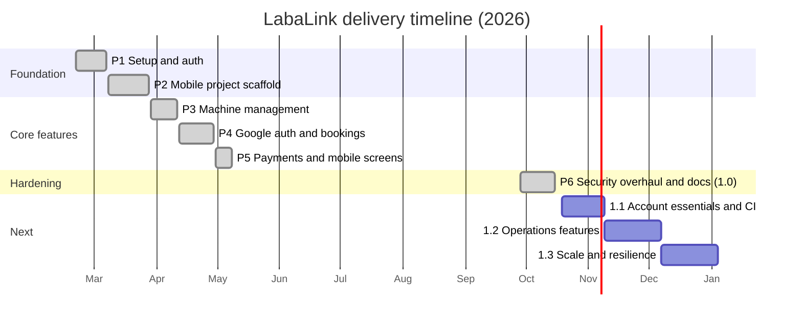

# Implementation Plan

| | |
|---|---|
| **Project** | LabaLink |
| **Date** | 2026-10-15 |
| **Related** | [PRD](PRD.md) · [SRS](SRS.md) · [Roadmap](../ROADMAP.md) · [Changelog](../CHANGELOG.md) |

This plan covers how LabaLink was built (phases 1–5), the 1.0 security
hardening (phase 6), and how the next milestones will be delivered. Each
phase lists its scope, tasks, exit criteria and status.

---

## 1. Timeline

## 2. Work breakdown

### Phase 1: Project setup and authentication ✅
- Monorepo layout (`backend/`, `web/`, `mobiledev/`).
- Spring Boot project, PostgreSQL connection, `User` entity.
- Register and login endpoints with BCrypt and JWT.
- React login and register pages.
- **Exit:** a user can register and log in from the web.

### Phase 2: Mobile scaffold ✅
- Android project, Retrofit client, login and register screens.
- **Exit:** login works from the emulator.

### Phase 3: Machine management ✅
- `Machine` entity, CRUD API, QR token generation.
- Web machine table, add/edit/delete modals, stat cards.
- **Exit:** an attendant can manage machines.

### Phase 4: Google sign-in and bookings ✅
- Google OAuth2 login (web), Google Sign-In (mobile).
- `Booking` entity and API, web bookings page with status actions.
- WebSocket (STOMP) live updates and email notifications.
- **Exit:** bookings can be created and progressed, and update live.

### Phase 5: Payments and mobile screens ✅
- Stripe integration and wallet top-up.
- Mobile home, machine detail, bookings, wallet and QR scanner.
- **Exit:** a full demo flow works end to end.

### Phase 6: Security overhaul and stabilisation (1.0) ✅

A security review of the phase 1–5 code found critical issues (see
[SECURITY.md](../SECURITY.md#vulnerabilities-fixed-in-100)). This phase
fixed them and made the money flows correct.

| # | Workstream | Tasks | Status |
|---|---|---|---|
| 6.1 | **Authentication** | JWT filter on every request; JJWT 0.12; secret validation; token versioning and logout; BCrypt 12; password policy; login lockout; timing-safe login | ✅ |
| 6.2 | **Authorisation** | Deny-by-default URL rules; `@PreAuthorize` roles; ownership checks with 404; `/me` endpoints; remove self-assigned roles; attendant provisioning and bootstrap | ✅ |
| 6.3 | **Google sign-in** | Verify Android ID tokens (JWKS); web one-time code handoff; remove the trust-the-client endpoint | ✅ |
| 6.4 | **Bookings and money** | Server pricing; QR verification; wallet debit and refund; state machine; row locks; `BigDecimal`/`NUMERIC`; DB constraints | ✅ |
| 6.5 | **Payments** | Stripe Checkout; `PaymentGateway` port; signed webhook; idempotent sync and credit with amount check; limits | ✅ |
| 6.6 | **Edge hardening** | CORS allow-list; security headers; rate limiting; safe error handler; secured WebSocket (auth + per-user queues) | ✅ |
| 6.7 | **Schema** | Flyway V1 (fresh + legacy upgrade), Hibernate validate | ✅ |
| 6.8 | **Web** | Central API client; session in sessionStorage; attendant-only guard; OAuth callback; Transactions and Staff pages; QR sticker printing; WebSocket hook fix; overlay fix; `npm audit` clean | ✅ |
| 6.9 | **Android** | Keystore token storage; auth interceptor and 401 handling; HTTPS-only release; backup exclusions; Stripe Checkout; QR flow fix; own-bookings and cancel; R8; lint clean | ✅ |
| 6.10 | **Tests** | 32 integration and unit tests on embedded PostgreSQL | ✅ |
| 6.11 | **Docs** | README, PRD, SRS, SDD, TRD, UI/UX, App Flow, Schema, this plan, Architecture, ADRs, Changelog, Roadmap, Security | ✅ |

**Exit criteria (met):**
- `./mvnw test`: 32/32 passing.
- `npm run lint` and `npm run build`: clean, 0 npm vulnerabilities.
- `./gradlew :app:assembleDebug :app:lintDebug :app:assembleRelease`:
  successful, 0 lint errors.
- No open critical or high items in the security review.

## 3. Upcoming milestones

### 1.1 Account essentials and CI (≈ 3 weeks)

| Task | Est. | Depends on |
|---|---|---|
| GitHub Actions: backend tests, web lint/build, Android build/lint | 1 d | — |
| Dependabot + `npm audit` / OWASP Dependency-Check gates | 0.5 d | CI |
| `password_reset_tokens` table (V2), request + confirm endpoints, email template | 2 d | — |
| Email verification on sign-up (V3) | 2 d | Reset email infra |
| Refresh tokens: table, rotation, reuse detection, per-device logout; client support | 4 d | — |
| Change password (web + app) | 1 d | — |
| Admin: deactivate or reactivate accounts | 1 d | — |
| Tests and docs for all of the above | 2 d | — |

### 1.2 Operations (≈ 4 weeks)
FCM push notifications · Android live updates via `/user/queue/*` ·
scheduled auto-complete of overdue sessions · duration picker ·
pagination · revenue charts · CSV export · OpenAPI docs.

### 1.3 Scale and resilience (≈ 4 weeks)
Redis for rate limits, lockouts and OAuth codes · RabbitMQ STOMP relay ·
Docker and compose · httpOnly cookie auth for web · certificate pinning ·
audit log · metrics.

## 4. Development workflow

1. **Branching:** `main` is always releasable. Work on `feature/<name>` or
   `fix/<name>` branches and open a pull request.
2. **Definition of done:**
   - Server-side validation and authorisation for every new endpoint
     (deny by default, check ownership).
   - Integration test for the happy path **and** at least one abuse case
     (wrong role, someone else's resource, bad input).
   - No secrets in code. New settings go in `application.yml` with env
     vars and `.env.example`.
   - Schema changes as a new Flyway migration.
   - Docs updated (TRD for API changes, CHANGELOG entry, ADR for
     significant decisions).
3. **Code review checklist:** authZ on new routes · no client-trusted
   IDs, prices or roles · money in `BigDecimal` with locks · errors through
   `ApiException` · side effects after commit · no PII or tokens in logs.
4. **Commits:** conventional style (`feat:`, `fix:`, `security:`,
   `docs:`, `test:`).

## 5. Test plan

| Level | Tooling | Scope |
|---|---|---|
| Unit | JUnit 5 | Filters and pure logic (`RateLimitFilterTest`) |
| Integration (API) | Spring Boot Test, MockMvc, embedded PostgreSQL | Security rules, booking and money flows, payments, migrations |
| Integration (WebSocket) | `WebSocketStompClient` + SockJS, random port | CONNECT auth, subscription rules, per-user delivery |
| Static analysis | ESLint, TypeScript strict, Android Lint | Web and mobile |
| Manual E2E | Emulator + browser + Stripe test mode | Full journey (see below) |

**Manual E2E script (each release):**
1. Start the API with a fresh DB and bootstrap attendant. Start the web
   app and the emulator.
2. Attendant: sign in → add a washer (₱30/h) → print the QR.
3. Customer: register → top up ₱100 with `4242 4242 4242 4242` → balance
   ₱100.
4. Customer: scan the QR → booking PENDING, balance ₱70; dashboard updates
   live.
5. Attendant: Activate → email; Complete → email; machine Available.
6. Customer: start another session → cancel while pending → refund to
   ₱70.
7. Negative checks: wrong QR → error; attendant login on Android →
   rejected; customer login on web → rejected; logout → old token rejected.

## 6. Release plan

1. Freeze `main`. Run the full test matrix (section 2, exit criteria).
2. Update `CHANGELOG.md` and version numbers (`pom.xml` and
   `versionCode`/`versionName`).
3. Tag `vX.Y.Z` and create a GitHub release with notes.
4. Deploy: run the API JAR (Flyway migrates on start) → publish `web/dist`
   with security headers → upload the signed AAB.
5. Smoke test: `/actuator/health`, sign-in on both apps, one Stripe test
   payment in staging.
6. Rollback: redeploy the previous JAR. Migrations are additive and
   backward compatible within a minor version.

## 7. Risks and mitigations

| Risk | Likelihood | Impact | Mitigation |
|---|---|---|---|
| Stripe webhooks unreachable in some environments | Medium | Top-ups pending | `sync` endpoint; app syncs on return |
| Breaking API change for old app versions | High (1.0) | Old apps fail | Release notes; force update; contract documented in TRD |
| Legacy DB upgrade issue | Low | Startup failure | Idempotent V1 + `LegacySchemaUpgradeTest`; back up the DB before upgrading |
| Single-instance limits | Low (one shop) | Can't scale out | Redis/RabbitMQ in 1.3 |
| Key leakage | Low | Severe | Env-only secrets, `.gitignore`, secret scanning, rotation procedure in SECURITY.md |
