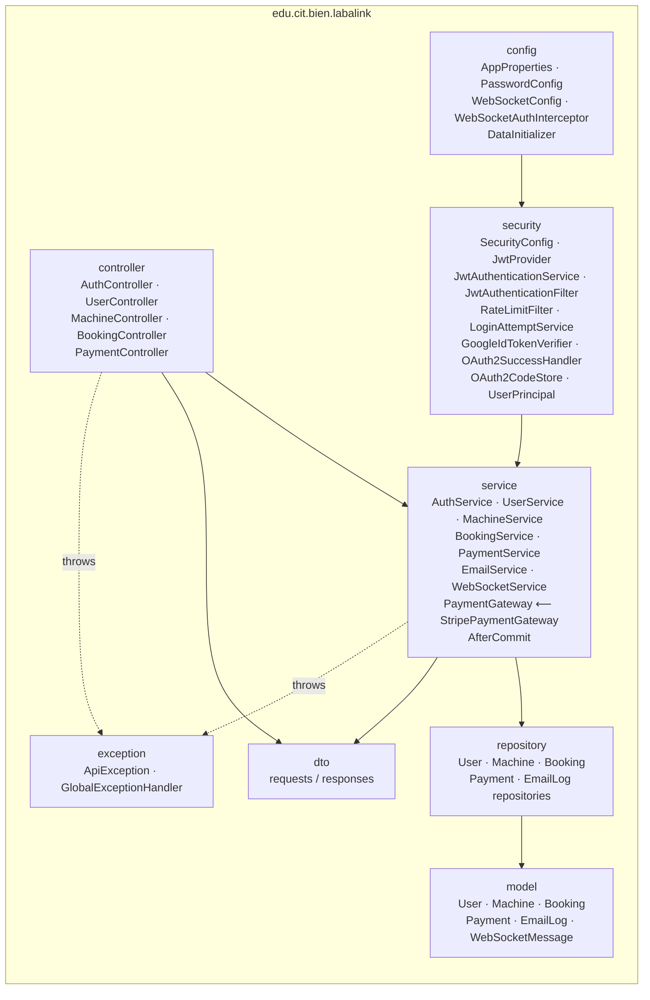
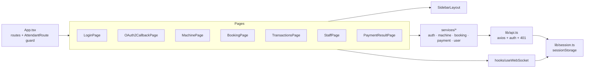
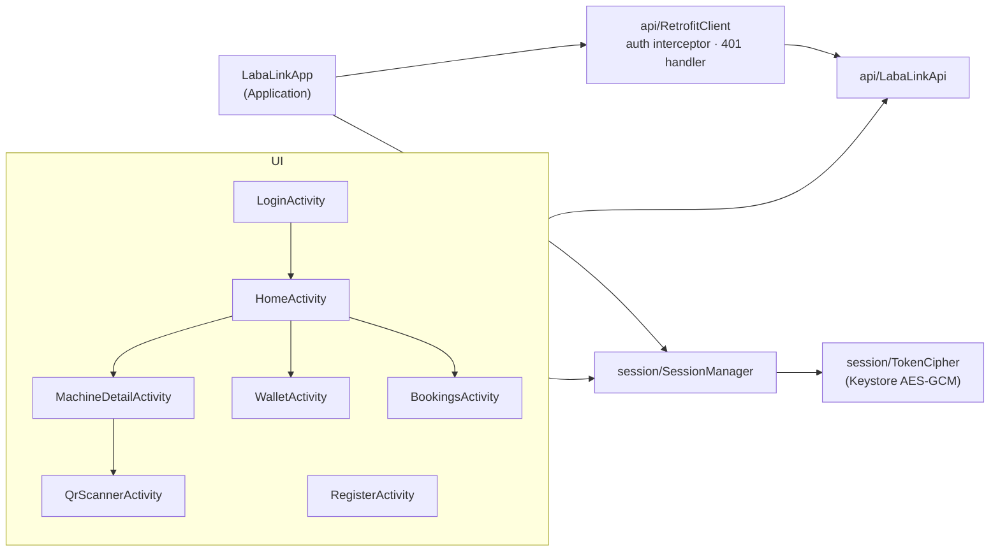
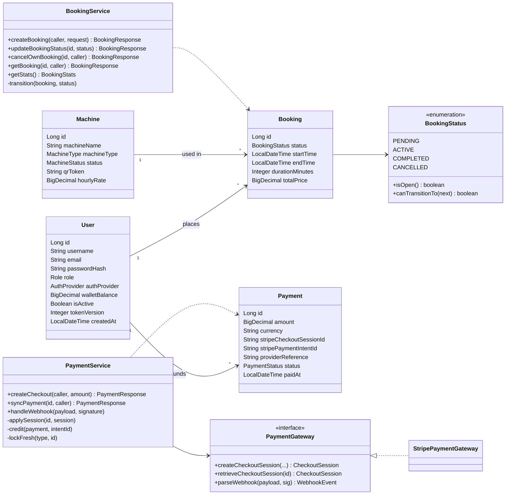
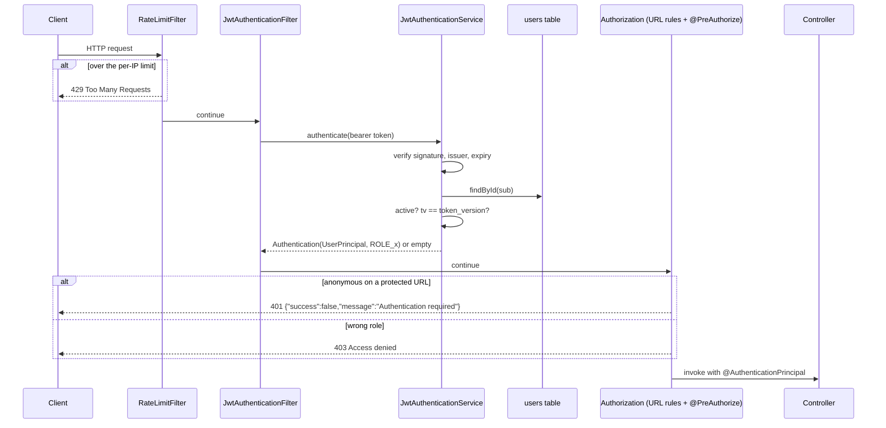
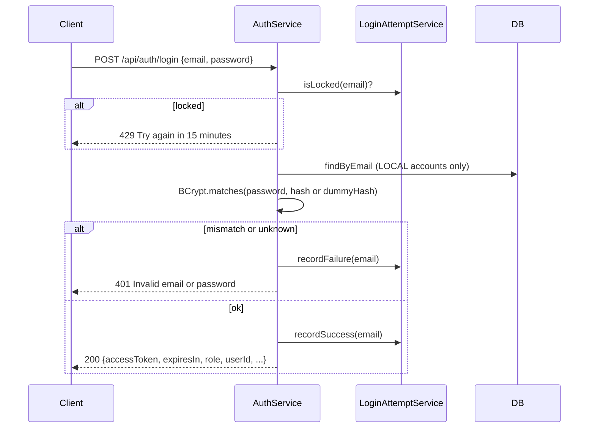
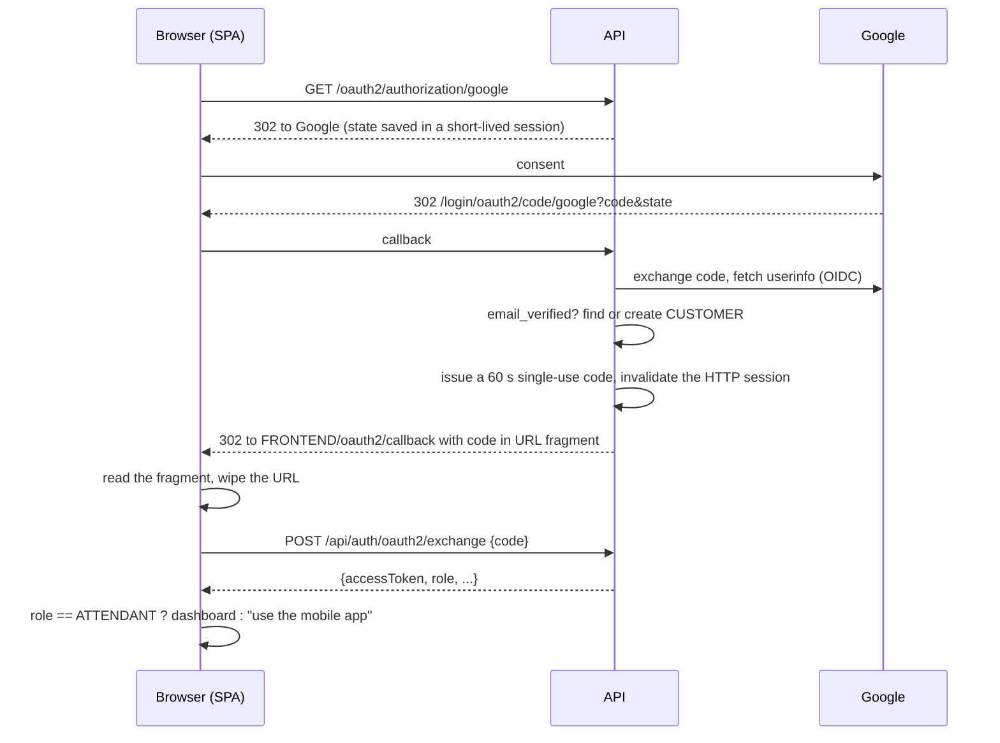
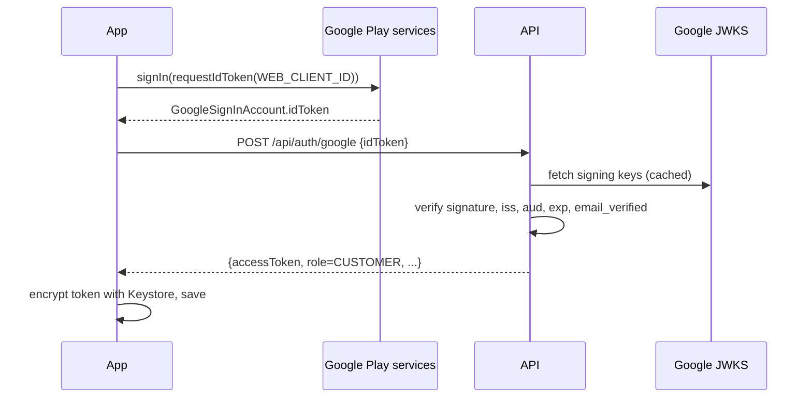
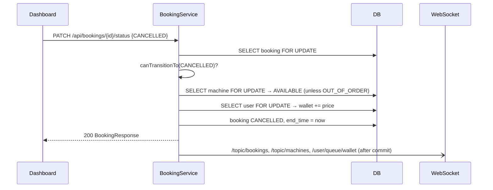

# Software Design Document (SDD)

| | |
|---|---|
| **System** | LabaLink 1.0 |
| **Date** | 2026-10-15 |
| **Standard** | Structure adapted from IEEE 1016 |
| **Related** | [SRS](SRS.md) · [TRD](TRD.md) · [Architecture](../ARCHITECTURE.md) · [Decisions](../DECISIONS.md) |

---

## 1. Introduction

This document describes **how** LabaLink meets the [SRS](SRS.md): its
decomposition, interfaces, data, algorithms and the reasoning behind key
designs. Architectural decisions are recorded as ADRs in
[DECISIONS.md](../DECISIONS.md).

## 2. Design overview

LabaLink is a three-tier, client-server system:

- **Presentation**: Android app (customers) and React SPA (attendants).
- **Application**: a Spring Boot API organised as edge → service →
  repository, plus ports for external providers.
- **Data**: PostgreSQL with Flyway-managed schema.

Design principles:

1. **The server is the authority.** Clients send intent (machine ID,
   scanned code, amount). The server decides identity, price, status and
   money.
2. **Deny by default.** Every endpoint is authenticated unless explicitly
   public. Role and ownership are checked separately.
3. **Money is transactional.** Row locks, exact decimals, idempotent state
   transitions, DB constraints.
4. **Side effects after commit.** Email and WebSocket pushes never announce
   rolled-back state.
5. **Ports for providers.** Stripe sits behind `PaymentGateway`, so business
   logic is testable offline.

## 3. Component design

### 3.1 Backend packages



### 3.2 Component responsibilities

| Component | Responsibility | Key collaborators |
|---|---|---|
| `SecurityConfig` | Filter chain, URL rules, CORS, headers, OAuth2 login, JSON 401/403 | `JwtAuthenticationFilter`, `RateLimitFilter`, `OAuth2SuccessHandler` |
| `JwtProvider` | Sign and verify HS256 tokens; enforce secret length | `AppProperties` |
| `JwtAuthenticationService` | Token → `Authentication` (user exists, active, token version matches) | `UserRepository` |
| `RateLimitFilter` | Per-IP fixed-window throttling of `/api/**` | — |
| `LoginAttemptService` | Per-email failure counter and lockout | — |
| `GoogleIdTokenVerifier` | Verify Google ID tokens through JWKS | Nimbus `JwtDecoder` |
| `OAuth2SuccessHandler` / `OAuth2CodeStore` | Web Google login → single-use code handoff | `AuthService` |
| `AuthService` | Register, login, Google, logout, create users | `PasswordEncoder`, `JwtProvider`, `EmailService` |
| `MachineService` | Machine CRUD, QR token generation and rotation | `BookingRepository`, `WebSocketService` |
| `BookingService` | Scan-to-start, state machine, refunds, stats | Machine/User/Booking repositories, `EmailService`, `WebSocketService` |
| `PaymentService` | Checkout creation, sync, webhook handling, idempotent credit | `PaymentGateway`, `EntityManager` |
| `StripePaymentGateway` | Stripe SDK calls with per-request API key and idempotency key | Stripe Java SDK |
| `WebSocketService` | Topic and per-user pushes | `SimpMessagingTemplate` |
| `WebSocketAuthInterceptor` | Authenticate CONNECT, authorise SUBSCRIBE, block SEND | `JwtAuthenticationService` |
| `EmailService` | Async HTML emails with escaping; logs every attempt | `JavaMailSender`, `EmailLogRepository` |
| `GlobalExceptionHandler` | Map exceptions to safe JSON responses | — |
| `DataInitializer` | Bootstrap the first attendant | `AuthService` |

### 3.3 Web dashboard modules



### 3.4 Android modules



## 4. Class design (domain and services)



## 5. Dynamic design

### 5.1 Request authentication pipeline



### 5.2 Password login



### 5.3 Web Google login (code handoff)



### 5.4 Android Google login



### 5.5 Attendant cancels with refund



The scan-to-start and top-up sequences are in
[ARCHITECTURE.md §4](../ARCHITECTURE.md#4-key-runtime-flows).

## 6. Data design

The relational model, constraints, indexes and migration strategy are in
[Backend-Schema.md](Backend-Schema.md). Highlights:

- `NUMERIC(12,2)` for balances and amounts, `NUMERIC(10,2)` for rates and
  prices.
- Unique: `users.email`, `machines.qr_token`, and the Stripe IDs on
  `payments` (partial unique indexes).
- `CHECK` constraints prevent negative wallets and non-positive amounts.
- Enumerations stored as `VARCHAR`; valid values enforced by JPA enums.

## 7. Algorithms and rules

### 7.1 Pricing
```
price = round_half_up(hourly_rate × duration_minutes ÷ 60, 2)
duration_minutes ∈ [15, 240], default 60
```

### 7.2 Idempotent crediting
```
lock payment row FOR UPDATE (refresh from DB)
if payment.status ≠ PENDING          → return            # already settled
if session.id ≠ payment.session_id   → log, return
if session.complete and paid:
    if session.amount_total ≠ payment.amount×100
       or currency mismatch          → status FAILED, return
    status SUCCESS, paid_at = now
    lock user row, wallet += amount
    after commit: email + /user/queue/wallet
elif session.expired                 → status FAILED
```

### 7.3 QR token
```
token = "LL-" + base64url(SecureRandom 18 bytes)     # 144 bits
compare: MessageDigest.isEqual(expected, scanned)   # constant time
```

### 7.4 Rate limiting
Fixed 60-second windows keyed by `auth:<ip>` (20 requests) or
`api:<ip>` (300 requests). Stale windows are evicted when more than 50,000
clients are tracked.

## 8. Interface design

- REST endpoints, payloads and error format: [TRD §5](TRD.md#5-api-contract).
- WebSocket destinations: [TRD §5.7](TRD.md#57-websocket-stomp).
- UI design and screens: [UI-UX-Design.md](UI-UX-Design.md).

## 9. Error handling design

| Source | Handling | Client sees |
|---|---|---|
| `ApiException` (business) | Status from the exception | `{"success":false,"message":"<safe message>"}` |
| Bean validation | 400, joined field messages | Specific validation messages |
| Malformed JSON or path type | 400 | "Malformed request" |
| Spring Security | 401 / 403 JSON | "Authentication required" / "Access denied" |
| Unique constraint | 409 | "Request conflicts with existing data" |
| Anything else | Logged with stack trace; 500 | "Something went wrong. Please try again." |

Clients show the `message` field (`errorMessage()` helpers in the web and
Android apps).

## 10. Deployment design

See [ARCHITECTURE.md §6](../ARCHITECTURE.md#6-deployment-view). The API is
one fat JAR (`./mvnw package`). The web app is static files (`npm run
build`). The Android app is an APK/AAB signed outside the repo.

## 11. Design for testability

- `PaymentGateway` interface, with `FakePaymentGateway` in tests.
- Embedded PostgreSQL ([ADR-016](../DECISIONS.md#adr-016-embedded-postgresql-for-integration-tests))
  so tests run the real migrations and locks.
- `@MockitoBean JavaMailSender` so email has no network dependency.
- Test suites: `SecurityIntegrationTest`, `BookingIntegrationTest`,
  `PaymentIntegrationTest`, `WebSocketSecurityTest`, `RateLimitFilterTest`,
  `LegacySchemaUpgradeTest`.
