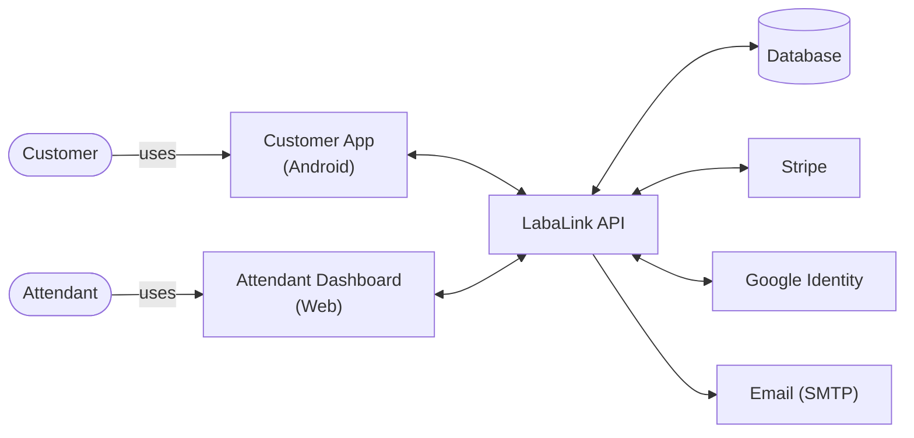
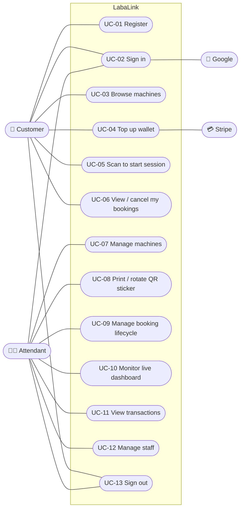
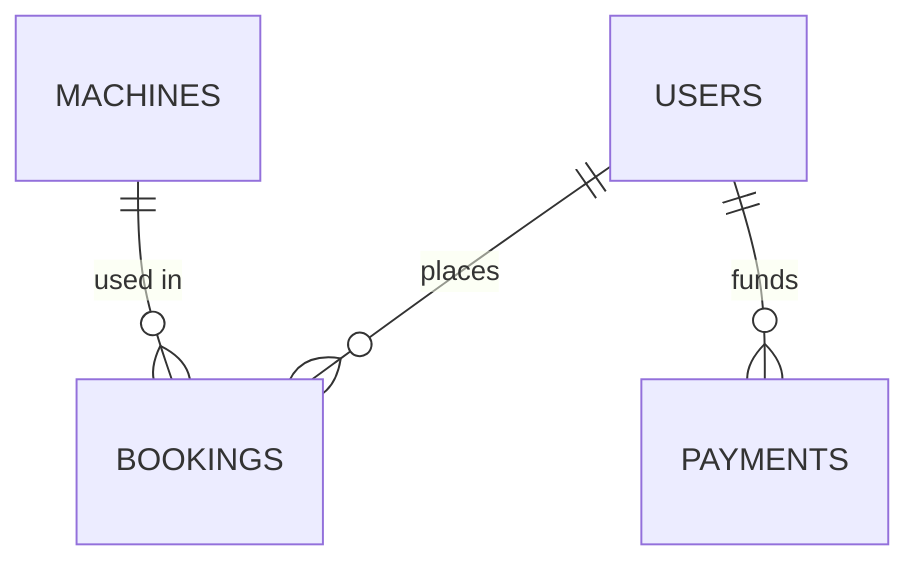
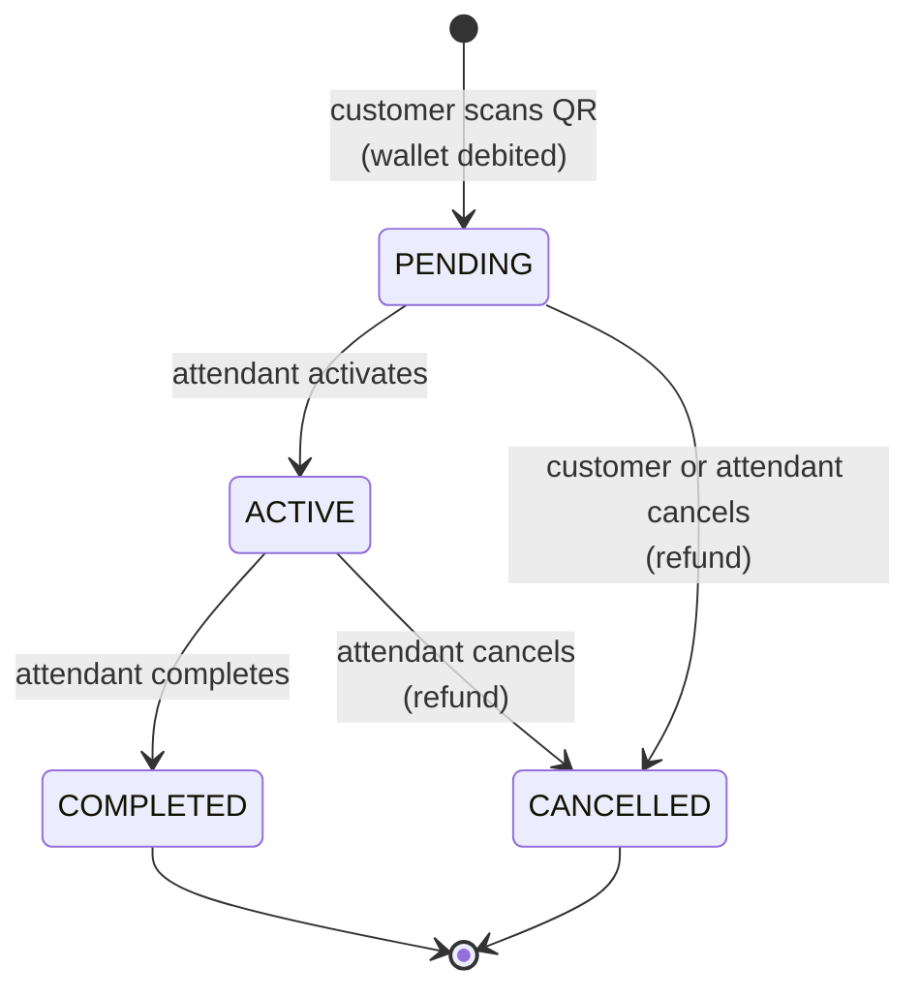
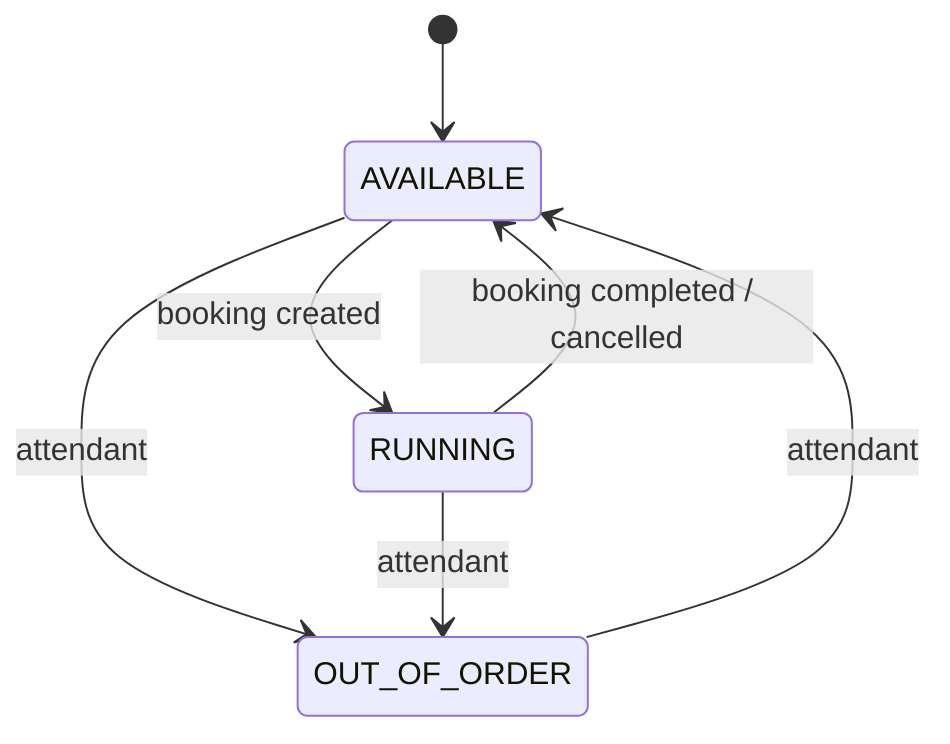
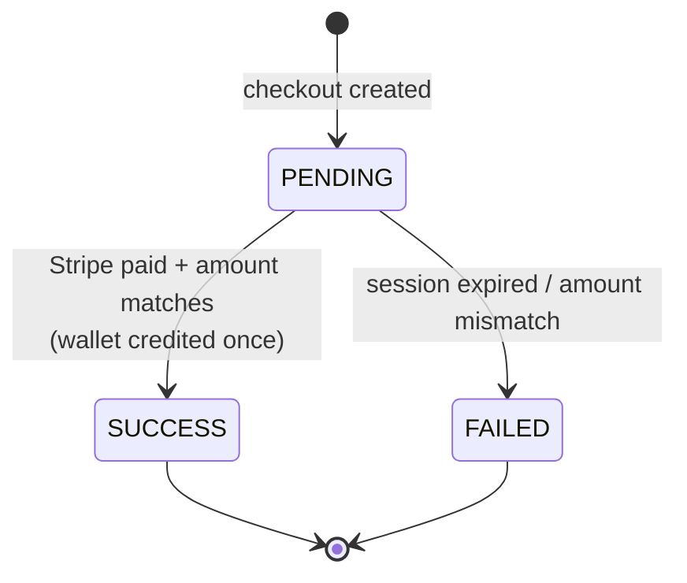
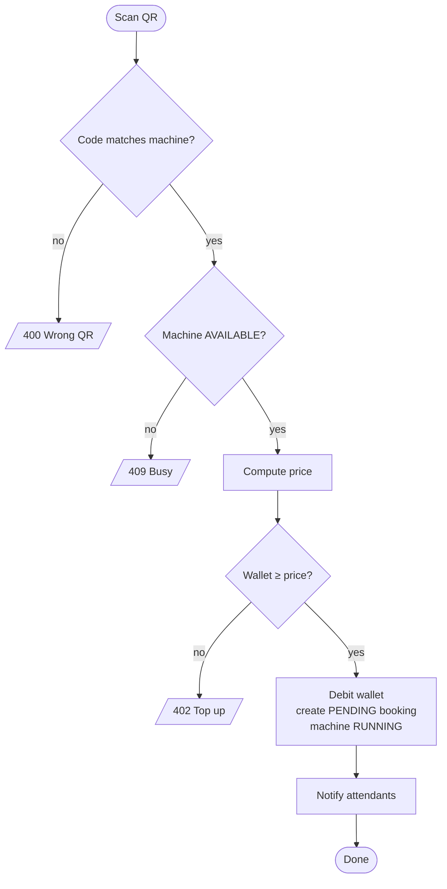

# Software Requirements Specification (SRS)

| | |
|---|---|
| **System** | LabaLink — Smart Laundry Management System |
| **Version** | 1.0 |
| **Date** | 2026-10-15 |
| **Standard** | Structure adapted from IEEE 830 / ISO/IEC/IEEE 29148 |

---

## 1. Introduction

### 1.1 Purpose
This document specifies the functional and non-functional requirements of
LabaLink 1.0. It is the reference for design ([SDD](SDD.md)), implementation
and acceptance testing.

### 1.2 Scope
LabaLink is made up of:

- **LabaLink API**: a Spring Boot REST and WebSocket service.
- **Attendant Dashboard**: a React single-page app.
- **Customer App**: an Android application.

It supports account management, machine management, QR-based session
start, a prepaid wallet funded through Stripe, real-time monitoring and
email notifications.

### 1.3 Definitions

| Term | Meaning |
|---|---|
| Customer | End user who washes laundry (role `CUSTOMER`) |
| Attendant | Shop staff (role `ATTENDANT`) |
| Machine | A washer or dryer, with status `AVAILABLE`, `RUNNING` or `OUT_OF_ORDER` |
| Booking / session | One paid use of a machine |
| QR token | Secret printed on a machine's sticker; proves physical presence |
| Wallet | Customer's prepaid PHP balance |
| Top-up | Adding funds to a wallet via Stripe Checkout |
| JWT | JSON Web Token used as the bearer access token |

### 1.4 References
[PRD](PRD.md) · [TRD](TRD.md) · [Backend Schema](Backend-Schema.md) ·
[SECURITY.md](../SECURITY.md) · OWASP ASVS 4.0 · OWASP Mobile Top 10.

## 2. Overall description

### 2.1 Product perspective (context diagram)

### 2.2 User classes

| Class | Channel | Frequency | Technical skill |
|---|---|---|---|
| Customer | Android app | Weekly | Low to medium |
| Attendant | Web dashboard (desktop) | Daily, all shift | Low |
| Administrator / owner | Web dashboard + config | Occasional | Medium |

### 2.3 Operating environment
- Server: JVM 17+, PostgreSQL 14+, Linux or Windows.
- Web: current Chrome, Edge, Firefox, Safari; desktop width ≥ 1024 px.
- Mobile: Android 7.0 (API 24) or later, with a camera for QR scanning.

### 2.4 Constraints
- Payments must use Stripe. Card data must never be stored or transmitted
  by LabaLink.
- Currency is PHP only.
- The API is designed to run as a single instance in 1.0
  (see [ADR-009](../DECISIONS.md#adr-009-in-memory-rate-limiting-and-lockout)).

### 2.5 Assumptions
- Attendants manually confirm that a machine has physically started
  ("Activate").
- Each machine has a printed QR sticker generated by the dashboard.

## 3. Use cases

### 3.1 Use case diagram

### 3.2 Use case specifications

#### UC-05 Scan to start session (core)

| | |
|---|---|
| **Actor** | Customer |
| **Preconditions** | Signed in as a customer; machine is `AVAILABLE`; wallet ≥ price |
| **Trigger** | Customer taps *Scan & Start* on a machine |
| **Main flow** | 1. App opens the camera. 2. Customer scans the sticker. 3. App sends machine ID, scanned code and duration. 4. System locks the machine, verifies the code matches, checks it is available. 5. System computes the price and locks and debits the wallet. 6. System creates a `PENDING` booking and sets the machine `RUNNING`. 7. System notifies attendants live. 8. App shows success. |
| **Alternatives** | 4a. Code mismatch → "This QR code does not belong to the selected machine" (400). 4b. Machine busy → 409. 5a. Insufficient balance → 402 "Please top up first". |
| **Postconditions** | Wallet reduced by the price; booking stored; machine `RUNNING` |

#### UC-04 Top up wallet

| | |
|---|---|
| **Actor** | Customer, Stripe |
| **Main flow** | 1. Customer picks or enters an amount (₱50–₱10,000). 2. System records a `PENDING` payment and creates a Stripe Checkout Session. 3. App opens Stripe's page. 4. Customer pays. 5. Stripe sends a signed webhook, **or** the app asks the system to sync on return. 6. System verifies paid status, amount and currency with Stripe. 7. System marks the payment `SUCCESS` and credits the wallet once. 8. Email and live wallet update. |
| **Alternatives** | 4a. Customer cancels → the payment stays `PENDING` until the session expires, then becomes `FAILED`. 6a. Amount mismatch → `FAILED`, no credit, logged. |

#### UC-09 Manage booking lifecycle

| | |
|---|---|
| **Actor** | Attendant |
| **Main flow** | Attendant sees a `PENDING` booking → *Activate* (customer emailed) → after the wash, *Complete* (machine `AVAILABLE`, customer emailed). |
| **Alternative** | *Cancel* from `PENDING` or `ACTIVE` → confirmation dialog → full refund, machine `AVAILABLE`. |
| **Business rule** | Invalid transitions (e.g., `PENDING → COMPLETED`) are rejected with 409. |

#### UC-02 Sign in

| | |
|---|---|
| **Main flow (password)** | Enter email and password → system verifies → returns a JWT (60 min) → client checks the role (web: attendant only; app: customer only). |
| **Main flow (Google, app)** | Google account picker → app receives an ID token → system verifies it with Google → signs in or creates a customer account. |
| **Main flow (Google, web)** | Redirect to Google → callback → system issues a one-time code → web exchanges it for a JWT. |
| **Exceptions** | Wrong credentials → generic error; 5 failures → locked 15 min (429); disabled account → 403. |

## 4. Functional requirements

Each requirement has an ID, a statement and a verification method
(**T** = automated test, **I** = inspection, **D** = demonstration).

### 4.1 Authentication and accounts (AUTH)

| ID | Requirement | Verify |
|---|---|---|
| FR-AUTH-01 | The system shall let a visitor register with username (3–50 chars), email and password. | T |
| FR-AUTH-02 | Passwords shall be 8–72 characters and contain at least one letter and one digit. | T |
| FR-AUTH-03 | Self-registration shall always create a `CUSTOMER`, ignoring any role in the request. | T |
| FR-AUTH-04 | The system shall authenticate with email and password and return a signed JWT with an expiry. | T |
| FR-AUTH-05 | Login failures shall return the same message whether the email exists or not. | T |
| FR-AUTH-06 | After 5 consecutive failures the account shall be locked for 15 minutes. | T |
| FR-AUTH-07 | The system shall accept Google sign-in only with a Google-verified ID token (app) or OAuth2 code flow (web). | T |
| FR-AUTH-08 | Google sign-in shall create new accounts as `CUSTOMER` only. | I |
| FR-AUTH-09 | Logout shall invalidate all of the user's previously issued tokens. | T |
| FR-AUTH-10 | Attendants shall be able to create attendant accounts; no one else can. | T |
| FR-AUTH-11 | The first attendant shall be creatable from configuration at startup. | I |
| FR-AUTH-12 | A welcome email shall be sent on account creation. | D |

### 4.2 Machines (MACH)

| ID | Requirement | Verify |
|---|---|---|
| FR-MACH-01 | Signed-in users shall see all machines with ID, name, type, status and hourly rate. | T |
| FR-MACH-02 | Attendants shall create, update and delete machines. Customers shall receive 403. | T |
| FR-MACH-03 | Each machine shall get a unique, unguessable QR token on creation. | T |
| FR-MACH-04 | QR tokens shall be returned only to attendants. | T |
| FR-MACH-05 | Attendants shall regenerate a machine's QR token. | I |
| FR-MACH-06 | Machines with booking history shall not be deletable (409). | T |
| FR-MACH-07 | Hourly rate shall be between ₱1.00 and ₱10,000.00 with at most 2 decimals. | I |
| FR-MACH-08 | The dashboard shall render a printable QR sticker for each machine. | D |

### 4.3 Bookings (BOOK)

| ID | Requirement | Verify |
|---|---|---|
| FR-BOOK-01 | Only customers shall create bookings, and only for themselves. | T |
| FR-BOOK-02 | Creating a booking shall require the machine's correct QR token. | T |
| FR-BOOK-03 | Only `AVAILABLE` machines shall be bookable. | T |
| FR-BOOK-04 | The price shall be computed by the server from the hourly rate and duration (15–240 min). | T |
| FR-BOOK-05 | The price shall be debited from the wallet atomically with booking creation; insufficient funds → 402. | T |
| FR-BOOK-06 | Customers shall list only their own bookings; others' bookings return 404. | T |
| FR-BOOK-07 | Attendants shall list all bookings, optionally filtered by status. | I |
| FR-BOOK-08 | Status changes shall follow `PENDING→ACTIVE→COMPLETED` and `PENDING/ACTIVE→CANCELLED` only. | T |
| FR-BOOK-09 | Cancelling shall refund the full price and free the machine. | T |
| FR-BOOK-10 | Customers shall cancel their own booking only while `PENDING`. | T |
| FR-BOOK-11 | Activation and completion shall email the customer. | D |
| FR-BOOK-12 | Attendants shall see totals: all, pending, active and completed revenue. | I |

### 4.4 Wallet and payments (PAY)

| ID | Requirement | Verify |
|---|---|---|
| FR-PAY-01 | Customers shall start a top-up of ₱50–₱10,000; the balance may not exceed ₱50,000. | T |
| FR-PAY-02 | Card details shall be collected only on Stripe's hosted Checkout page. | I |
| FR-PAY-03 | The wallet shall be credited only when Stripe reports the session complete and paid. | T |
| FR-PAY-04 | The credited amount and currency shall match the payment record; mismatches → `FAILED`. | T |
| FR-PAY-05 | A payment shall be credited at most once, whatever the number of webhooks or syncs. | T |
| FR-PAY-06 | Webhooks shall be rejected unless the Stripe signature is valid. | T |
| FR-PAY-07 | Customers shall view only their own payments and balance. | T |
| FR-PAY-08 | Attendants shall view all payments. | I |
| FR-PAY-09 | A successful top-up shall email the customer and push a live balance update. | D |

### 4.5 Real-time (RT)

| ID | Requirement | Verify |
|---|---|---|
| FR-RT-01 | WebSocket connections shall require a valid JWT. | T |
| FR-RT-02 | Machine changes shall be broadcast to signed-in clients without QR tokens. | I |
| FR-RT-03 | Booking changes shall be broadcast to attendants only. | T |
| FR-RT-04 | Wallet and booking changes shall be sent privately to the owning customer. | T |
| FR-RT-05 | The dashboard shall reconnect automatically after connection loss. | D |

## 5. Non-functional requirements

### 5.1 Security (highest priority)

| ID | Requirement |
|---|---|
| NFR-SEC-01 | All API endpoints except register, login, Google, code exchange and the Stripe webhook shall require authentication. |
| NFR-SEC-02 | Authorisation shall be enforced on the server for role and ownership on every request. |
| NFR-SEC-03 | Passwords shall be hashed with BCrypt (cost ≥ 12). |
| NFR-SEC-04 | Access tokens shall expire in ≤ 60 minutes and be revocable. |
| NFR-SEC-05 | Authentication endpoints shall be rate limited per client IP. |
| NFR-SEC-06 | CORS and WebSocket origins shall be restricted to configured origins. |
| NFR-SEC-07 | Responses shall include CSP, frame, content-type, referrer and HSTS headers. |
| NFR-SEC-08 | Error responses shall not include stack traces, SQL or internal messages. |
| NFR-SEC-09 | Secrets shall not be stored in source control. |
| NFR-SEC-10 | Production traffic shall use TLS; the release Android app shall refuse cleartext HTTP. |
| NFR-SEC-11 | The Android app shall store tokens encrypted with a hardware-backed (Keystore) key and exclude them from backups. |
| NFR-SEC-12 | Money shall use exact decimal types, row-level locking and DB constraints. |
| NFR-SEC-13 | Dependencies shall have no known critical or high vulnerabilities at release. |

### 5.2 Performance

| ID | Requirement |
|---|---|
| NFR-PERF-01 | p95 latency < 300 ms for reads and < 600 ms for booking or top-up creation at 50 concurrent users (excluding Stripe latency). |
| NFR-PERF-02 | Live updates reach connected dashboards within 2 s of the commit. |
| NFR-PERF-03 | The web bundle shall be < 200 KB gzipped. |

### 5.3 Reliability and availability

| ID | Requirement |
|---|---|
| NFR-REL-01 | Financial operations shall be atomic (all or nothing). |
| NFR-REL-02 | Side effects (email, WebSocket) shall run only after a successful commit. |
| NFR-REL-03 | Email failures shall not fail the business operation; they are logged in `email_logs`. |
| NFR-REL-04 | Top-ups shall be confirmable without webhooks (sync with Stripe). |
| NFR-REL-05 | Availability ≥ 99% during shop hours. |

### 5.4 Usability and accessibility

| ID | Requirement |
|---|---|
| NFR-USE-01 | Form controls shall have labels; dialogs use `role="dialog"` and `aria-modal`. |
| NFR-USE-02 | Errors shall be shown in plain language next to the action. |
| NFR-USE-03 | Destructive actions (delete, cancel and refund, rotate QR) shall ask for confirmation. |
| NFR-USE-04 | Text contrast shall meet WCAG 2.1 AA for body text. |

### 5.5 Maintainability and portability

| ID | Requirement |
|---|---|
| NFR-MNT-01 | Schema changes shall be versioned Flyway migrations. |
| NFR-MNT-02 | The backend shall have automated integration tests for security and money flows. |
| NFR-MNT-03 | Configuration shall come from the environment (12-factor). |

### 5.6 Privacy

| ID | Requirement |
|---|---|
| NFR-PRV-01 | Only the name and email of users shall be collected. |
| NFR-PRV-02 | Customer emails shall be visible only to attendants and the customer. |

## 6. External interface requirements

- **User interfaces:** see [UI/UX Design](UI-UX-Design.md) and [App Flow](App-Flow.md).
- **Software interfaces:** REST/JSON and STOMP over SockJS (see [TRD §5](TRD.md#5-api-contract)); Stripe API; Google OAuth2/OIDC; SMTP.
- **Communication:** HTTPS (TLS 1.2+) in production; WebSocket over the same origin as the API.

## 7. Data requirements

Entities: User, Machine, Booking, Payment, EmailLog. Full definitions,
constraints and the ERD are in [Backend Schema](Backend-Schema.md).

## 8. Behavioural models

### 8.1 Booking state machine

### 8.2 Machine status

### 8.3 Payment status

### 8.4 Activity: scan to start

## 9. Acceptance criteria

1. Every requirement marked **T** has a passing automated test
   (`backend/src/test`).
2. All **D** requirements are demonstrated end to end: register → top up
   (Stripe test card) → scan → activate → complete → emails received.
3. Security checklist in [SECURITY.md](../SECURITY.md) reviewed with no open
   critical or high items.

## 10. Traceability (excerpt)

| Requirement | Test |
|---|---|
| FR-AUTH-03 | `SecurityIntegrationTest.registrationCannotSelfAssignAttendantRole` |
| FR-AUTH-05 | `SecurityIntegrationTest.unknownEmailAndWrongPasswordLookIdentical` |
| FR-AUTH-06 | `SecurityIntegrationTest.repeatedFailedLoginsLockTheAccount` |
| FR-AUTH-07 | `SecurityIntegrationTest.googleEndpointRejectsUnverifiableTokens`, `legacyTrustTheClientGoogleEndpointIsGone` |
| FR-AUTH-09 | `SecurityIntegrationTest.tamperedAndRevokedTokensAreRejected` |
| FR-MACH-04 | `SecurityIntegrationTest.qrTokensAreOnlyVisibleToAttendants` |
| FR-MACH-06 | `BookingIntegrationTest.machinesWithHistoryCannotBeDeleted` |
| FR-BOOK-02 | `BookingIntegrationTest.bookingRequiresTheRealQrCode` |
| FR-BOOK-04/05 | `BookingIntegrationTest.bookingIsPricedByServerAndChargedToWallet`, `insufficientBalanceIsRejected` |
| FR-BOOK-06 | `BookingIntegrationTest.bookingsArePrivateToOwnerAndAttendants` |
| FR-BOOK-08/09 | `BookingIntegrationTest.cancellingRefundsAndFreesTheMachine` |
| FR-PAY-01 | `PaymentIntegrationTest.topUpLimitsAreEnforced` |
| FR-PAY-03/05 | `PaymentIntegrationTest.walletIsCreditedOnlyOnceAndOnlyWhenPaid` |
| FR-PAY-04 | `PaymentIntegrationTest.amountMismatchIsNeverCredited` |
| FR-PAY-06 | `PaymentIntegrationTest.forgedWebhooksAreRejected` |
| FR-PAY-07 | `PaymentIntegrationTest.customersCannotTouchOtherPeoplesPayments` |
| FR-RT-01/03/04 | `WebSocketSecurityTest.*` |
| NFR-SEC-05 | `RateLimitFilterTest.*` |
| NFR-SEC-06/07 | `SecurityIntegrationTest.corsOnlyAllowsConfiguredOrigins`, `responsesCarrySecurityHeaders` |
| NFR-MNT-01 | `LegacySchemaUpgradeTest` |
